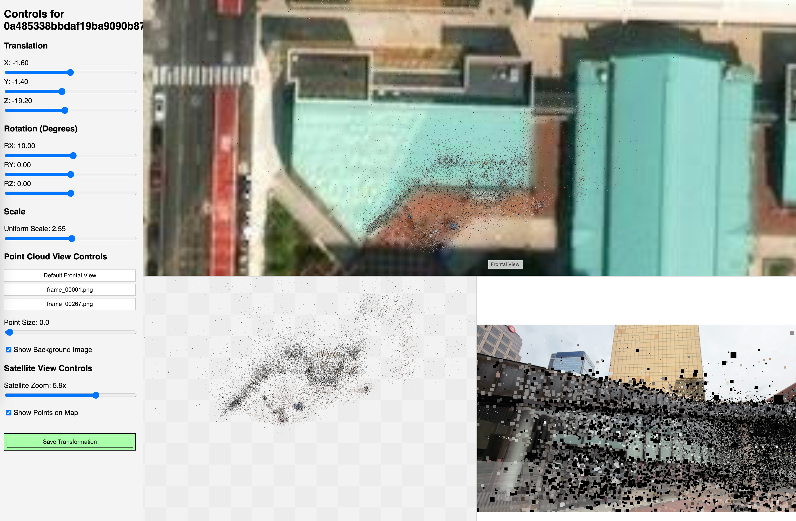

# Web tool for manually aligning point clouds to satellite views.




Runs on django, renders using three.js and leaflet.js. 

## Setup
Setup by installing the environment:
```
mamba env create -f environment.yml
```

Then, install JS libraries:
```
bash setup.sh
```

Finally, run the server:
```
cd geoaligner_project
python manage.py runserver
```

Before first use you need to migrate django models and create superuser:
```
cd geoaligner_project
python manage.py makemigrations geoaligner
python manage.py migrate
python manage.py createsuperuser
```

## How to Use

In terminal run the development server: `python manage.py runserver`.

### To populate the point cloud database using web interface:

1 Go to http://127.0.0.1:8000/admin/.

2 Log in with your superuser account.

3 Go to "Point Cloud Sets" and click "Add".

4 Give it a name, upload your points3D.bin file computed by colmap, and enter the correct latitude and longitude. Save it.

### To align the point cloud:

1 Navigate to http://127.0.0.1:8000/.

2 Click the link for the set you just created.

3 You should now see the alignment interface. Use the sliders to move, rotate, and scale the point cloud. The changes will be reflected in both the 3D view and the overhead map view.

- Left-click dragging in the map overlay view will translate the point cloud along the XY (ground) plane.
- Rigth-click dragging in the map overlay view will translate the point cloud along the Z axis, i.e. elevation change.
- Left-click dragging in the left point cloud view will rotate the point cloud along YZ plane (around the X axis).
- Right-click dragging in the left point cloud view will rotate the point cloud along XZ plane (around the Y axis).
- When in default frontal view, Left-click dragging in the right point cloud view will translate the camera. The point cloud transformation stays the same.
- When in default frontal view, Right-click dragging in the right point cloud view will rotate the camera. The point cloud transformation stays the same.
- Switch between example images in Point Cloud View Control to understand what the point cloud represents

4 Click "Save Transformation" to persist your changes to the server's database.

### To download all point cloud transforms:

Using web interface, you can navigate to http://127.0.0.1:8000/export and save the output as a file.

The format is a json, with scene id (database id), name, lat, lon and transform.

The transform is applied to the point cloud and the order is rotation, scale, translation, which would align the point cloud to the lat lon coordinate on the satellite view.

Alternatively, you can use dumpdata command:
`python manage.py dumpdata geoaligner.PointCloudSet --indent=2 > geoaligner_data.json`


### To populate the point cloud database using a script:
You can add commands in `geoaligner/management/commands/` folder to be able to run them with `python manage.py`.

Currently, there is `add_dl3dv_benchmark_localizable.py` file with the command to populate DB with localizable scenes of DL3DV Benchmark dataset. You will need CSV file with lat/lon data,
you can save the CSV of the IS_LOCALATION_FOUND tab of [this spreadsheet](https://docs.google.com/spreadsheets/d/1w8KPjHcdIvWpvot1XGgI5YMq0LhbjcXbPJtfsYC-NPs/edit?gid=678905690#gid=678905690).


Here is an example of running it:
```
python manage.py add_dl3dv_benchmark_localizable \
    --dl3dv_csv_path /Users/daniyar/Downloads/dl3dv/DL3DV-Benchmark\ -\ IS_LOCATION_FOUND.csv \
    --dataset_path /Users/daniyar/Downloads/dl3dv/DL3DV-10K-Benchmark_localizable \
    --scene 0a485338bbdaf19ba9090b874bb36ef0599a9c9a475a382c22903cf5981c6ea6 \
    --images /Users/daniyar/Downloads/dl3dv/DL3DV-10K-Benchmark_localizable/0a485338bbdaf19ba9090b874bb36ef0599a9c9a475a382c22903cf5981c6ea6/gaussian_splat/images_4/frame_00001.png \
             /Users/daniyar/Downloads/dl3dv/DL3DV-10K-Benchmark_localizable/0a485338bbdaf19ba9090b874bb36ef0599a9c9a475a382c22903cf5981c6ea6/gaussian_splat/images_4/frame_00267.png
```

## Coordinate Conventions

See `geoaligner/utils` folder where `point_cloud_file.py` is used to read and write point cloud data for the web, and `colmap_parsing_utils.py` defines a transformation of COLMAP camera to Three.js-compatible camera.

This means that **point clouds** follow ENU convention: X is EAST, Y is NORTH, Z is UP.

In three.js convention the **projection** is using OpenGL convention, so in the **local coordinate frame**, X is right, Y is up and Z is backward. Thus, camera world_to_cam transformations are modified to account for this change in the local coordinate frame for a projection.

In leaflet.js the typical coordinate frame of the view is also in ENU format: X is east, Y is north and Z is up.

In `geoalinger.js` there is a line that maps the points (in meters) to pixels in the map overlay view:
```
const metersPerPixel = 156543.03392 * Math.cos(centerLatLng.lat * Math.PI / 180) / Math.pow(2, zoom);
```
The constant `156543.03392` in JavaScript code represents the *meters per pixel at the Earth's equator when the map zoom level is 0.*

1.  *Web Mercator Projection (EPSG:3857):* Leaflet.js, and most web mapping services (like Google Maps, OpenStreetMap), use the Web Mercator projection. In this projection, the entire Earth at zoom level 0 is effectively mapped onto a square. For tile-based systems, this square has a standard width (and height) of `256` pixels.

2.  *Earth's Equatorial Circumference:* The Earth's circumference at the equator is approximately `40,075,016.686` meters (using the WGS84 semi-major axis of 6,378,137 meters for the Earth's radius, and the formula `2 * π * Radius`).

3.  *Meters per Pixel at Zoom 0 (Equator):*
    If the entire equatorial circumference (40,075,016.686 meters) is mapped to 256 pixels at zoom level 0, then the meters per pixel at the equator at zoom 0 is:
    `40,075,016.686 meters / 256 pixels ≈ 156,543.0339296875 meters/pixel`

    This exactly matches your constant `156543.03392`.
